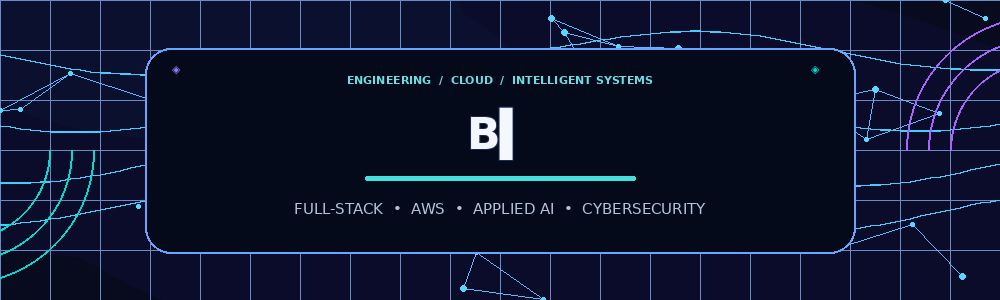

<!-- This is a real animated GIF stored in this repository. Keep the assets folder when uploading. -->

 

 

---

## 👋 About Me

I build **full-stack applications, AI-powered workflows, and cloud-oriented solutions**. I enjoy working across the stack—from designing APIs and data models to integrating language models and deploying applications.

- ☁️ **Cloud:** Advanced AWS knowledge, with a focus on cloud architecture, infrastructure, networking, identity, deployment, and operations.
- 🧩 **Software Engineering:** Backend services, REST APIs, database-driven applications, and frontend development.
- 🤖 **AI & LLMs:** OpenAI and Gemini API integration, prompt engineering, OCR workflows, and practical LLM applications.
- 🛡️ **Security:** Application and network security practice, including LLM prompt-injection risks and hands-on security labs.
- ⚙️ **DevOps:** Exploring Docker, Kubernetes, and deployment automation.

I like turning ideas into working software, understanding how systems behave, and building with reliability and security in mind.

---

## 🧰 Tech Stack

**Languages**  

**Backend & Frameworks**  

**Cloud, Systems & DevOps**  

  
  
  
  
  
  

---

  

## 🚀 Featured Projects

| Project | What it does | Technologies | Focus |
|---|---|---|---|
| **🛡️ AI Prompt Injection Detector** | Web application concept that inspects prompts for injection and jailbreak attempts before they reach an AI model. Combines rule-based pattern checks with AI-based intent and context analysis, with Safe/Unsafe classification and confidence scoring. | Python · FastAPI / Flask · HTML · CSS · JavaScript | **AI Security · LLM Safety** |
| **🤖 WhatsApp AI Auto-Reply Bot** | Connects WhatsApp messaging workflows with the OpenAI API to generate AI-assisted replies and automate responses. | Python · OpenAI API · Automation | **AI Integration · APIs** |
| **🅿️ Vehicle Parking Management System** | Full-stack parking management system covering users, parking lots, vehicles, slots, reservations, payments, and activity logs. | Node.js · Express · MySQL · HTML · CSS · JavaScript | **Backend · Full-Stack · DBMS** |

## 🎨 Other Projects

| Project | Description | Technologies |
|---|---|---|
| **🎵 Spotify Clone** | Web-based music player interface inspired by Spotify, focused on frontend layout and interactive UI. | HTML · CSS · JavaScript |
| **🎬 Netflix Clone** | Netflix-inspired streaming interface with a modern, responsive frontend layout. | HTML · CSS · JavaScript |

---

## 🧠 AI, Prompt Engineering & LLM Security

I work with LLM APIs and prompt design, and I am particularly interested in making AI applications more reliable and secure.

- **Prompt engineering:** Structuring instructions, providing context, refining prompts, and testing model responses for useful and consistent outputs.
- **LLM integration:** Connecting model APIs to application workflows and handling user input and generated responses.
- **Prompt injection awareness:** Understanding instruction override attempts, jailbreak patterns, and risks to system prompts or confidential information.
- **Detection approach:** The AI Prompt Injection Detector reference design combines rule-based checks with AI-based intent/context analysis rather than relying only on keyword matching.
- **Safer application design:** Input validation, confidence scoring, rate limiting, HTTPS communication, and avoiding unnecessary storage of sensitive prompts.

---

## ☁️ AWS & Cloud Engineering

**AWS — Advanced**

Cloud architecture · Identity and access management · Networking · Compute · Storage · Deployment · Monitoring · Cloud security

I focus on understanding how cloud components fit together to support secure, scalable, and maintainable applications. I am also exploring containerisation and DevOps automation with Docker and Kubernetes.

---

## 🔐 Cybersecurity Practice

Hands-on practice in controlled lab environments, including:

- **Network reconnaissance:** Nmap host discovery, port scanning, and service enumeration.
- **Web security testing:** Burp Suite, Gobuster, request inspection, and directory discovery.
- **Network analysis:** Wireshark packet analysis and controlled MITM / ARP-poisoning simulations.
- **Linux security:** Enumeration, permissions, SUID analysis, and privilege-escalation concepts.
- **Security tools:** Kali Linux, Hydra, and John the Ripper.

*All security exercises are performed in authorised, isolated environments.*

---

## 📬 Let's Connect

I'm interested in software engineering, AWS/cloud projects, AI applications, and security-focused development.

  
  
  

  

